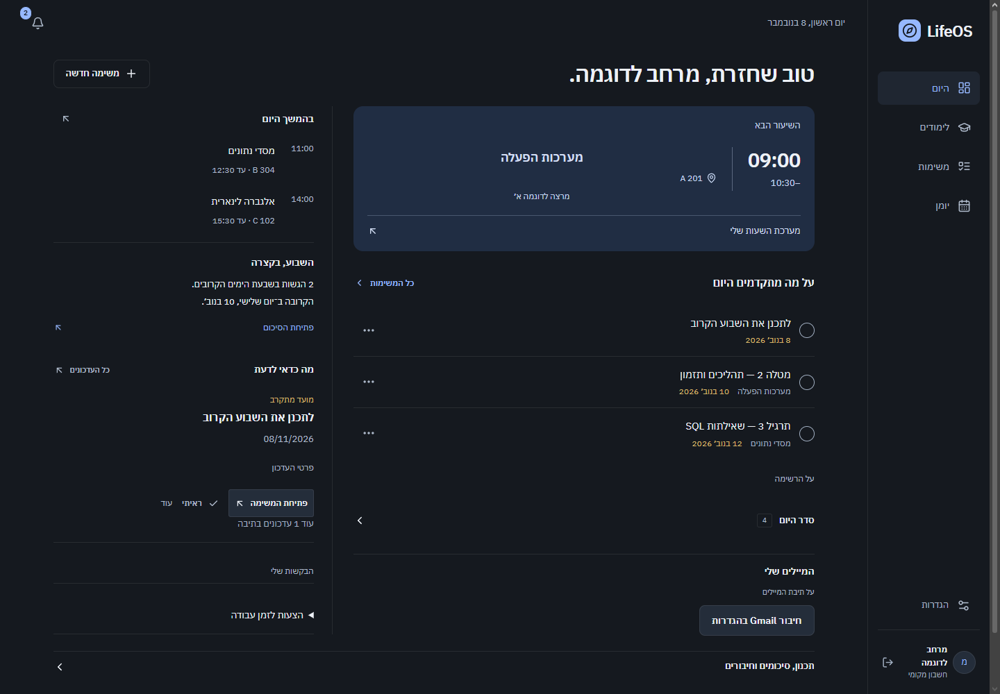
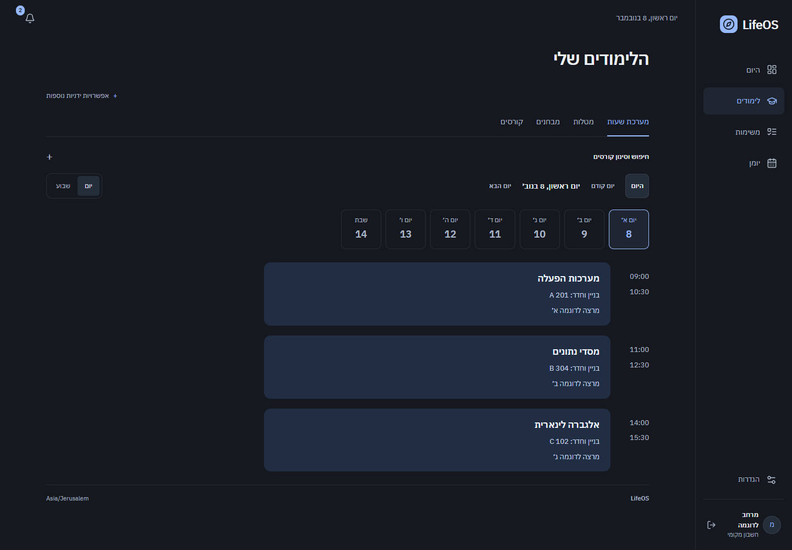
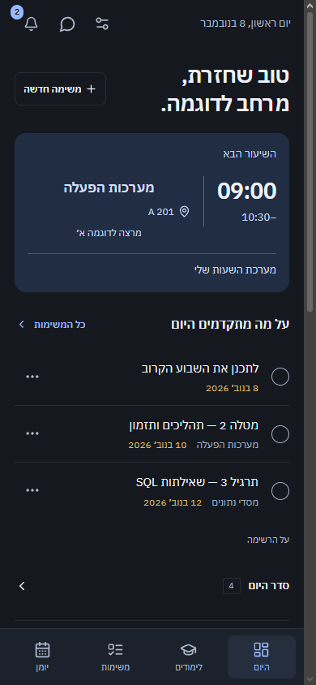
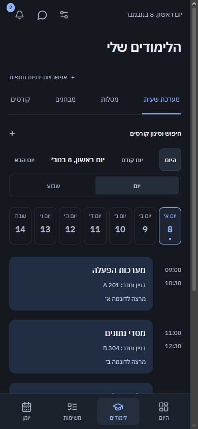

# LifeOS

**A local-first personal automation and productivity workspace for academic responsibilities, schedules, tasks and everyday workflows.**

LifeOS is a practical software engineering project shaped by continuous personal use. It brings scattered deadlines, calendar events and relevant updates into one interface, with a compact dashboard that emphasizes the next useful action rather than a wall of information.

The project combines a React/Next.js interface, a Python/FastAPI backend, persistent relational data and scheduled automation. It is designed for a private personal installation; this repository is source code, not a hosted public service.

## What it does

- **Daily workspace:** the next event or class, a small set of task priorities, relevant mail and concise daily/weekly overviews. Details are disclosed on demand.
- **Tasks and planning:** priorities, notes, date-only or timed deadlines, completion history, recorded requests and reviewed time-block/rescheduling proposals.
- **Calendar:** personal and authorized provider events, agenda/day/week/month views, recurring-event workflows and conflict indicators.
- **Academic organization:** terms, courses, linked assignments with submission dates, exams kept separate from actionable tasks, timetables, rooms and lecturers when supplied by the source.
- **Google integrations:** OAuth-based Calendar and Gmail connections. Relevant-message filtering and conservative explicit-date extraction are implemented; arbitrary email understanding is not claimed.
- **Institutional calendar feeds:** read-only deadline/event synchronization. Course-import comparison tooling exists, but live automatic enrollment discovery and submission-status imports are not complete.
- **Automation:** scheduled synchronization, opt-in briefings, reminders, Web Push and password-encrypted scheduled backups while the host is running.
- **Operational assistant:** reviewed task/event actions, schedule questions and app help. Optional local Ollama inference is supported; it is not a homework tutor, and cloud inference is not required.
- **Study files:** bounded document upload, text extraction and search. This is document search, not AI question answering.
- **Access and recovery:** password authentication, server-side sessions, optional account isolation, access-recovery keys, reviewed account deletion and offline backup recovery workflows.
- **Interface:** Hebrew RTL, English, dark/light/system appearance and an installable PWA shell. Offline editing is not implemented.

## Technology stack

| Layer | Implementation |
| --- | --- |
| Web | Next.js 16, React 19, TypeScript, CSS/Tailwind utilities, Radix UI, Lucide |
| API | Python, FastAPI, Pydantic, Uvicorn |
| Persistence | SQLite, SQLAlchemy 2, Alembic migrations |
| Automation | APScheduler and local worker processes |
| Integrations | Google OAuth/Calendar/Gmail, iCalendar feeds, Web Push |
| Protection | scrypt password hashing, CSRF/origin checks, credential vault, encrypted backups, build-derived CSP |
| Development checks | pytest, Vitest, Playwright, Ruff, ESLint, TypeScript |

See [architecture](docs/public/ARCHITECTURE.md) for boundaries and engineering tradeoffs.

## Run locally

Recommended development environment: **Python 3.12** and **Node.js 24 with npm**. The setup script accepts Python 3.11+, but the newer development tools have their own Node requirements.

From the repository root:

```powershell
python scripts/setup.py
npm --prefix apps/web run build -- --webpack
.\.venv\Scripts\python.exe scripts/run.py
```

On Windows, `Start-LifeOS.cmd` launches an installation after setup. The first local launch prompts for a password; there is no built-in personal password. Open `http://127.0.0.1:3000`. The API listens on `127.0.0.1:8765`; use the frontend rather than calling the API directly. Stop the launcher normally to stop its child processes.

On Linux/macOS, use `.venv/bin/python scripts/run.py`. For development, append `--dev`. Google, calendar-feed, push and local-model features are optional and require their own configuration/consent.

## Configuration

`.env.example` contains placeholders only. **It is documentation, not an automatically loaded environment file.** Set variables in the process that starts the launcher.

| Variable | Purpose |
| --- | --- |
| `LIFEOS_DATA_DIR` | Optional private storage directory outside the checkout |
| `LIFEOS_ACCOUNT_MODE` | Optional account-based workspace mode |
| `LIFEOS_GOOGLE_CLIENT_ID` / `LIFEOS_GOOGLE_CLIENT_SECRET` | Server-only Google application credentials |
| `LIFEOS_DEPLOYMENT_MODE` | Local mode by default; explicit server preparation is separate |
| `LIFEOS_PUBLIC_ORIGIN` | Validated HTTPS origin for explicit server mode |
| `LIFEOS_PILOT_OWNER_ID` | Optional pre-provisioned owner for a closed server pilot |

The launcher generates an internal API process key. Never expose it, provider tokens or credentials through `NEXT_PUBLIC_*`. Do not copy a working installation's configuration into this repository.

Default storage is the OS-local application-data directory on Windows, or `$XDG_DATA_HOME/lifeos` / `~/.local/share/lifeos` on Linux/macOS. The **working database is not encrypted**. Use OS/disk protections and keep it outside shared or cloud-synced directories. Provider-secret encryption and password-encrypted backups are separate controls.

## Project structure

```text
apps/web/                  Interface, same-origin proxy and PWA
services/api/lifeos/        Domain logic, authorization, providers and storage
services/api/alembic/       Explicit database migrations
services/worker/           Scheduled background work
scripts/                   Setup, launch, recovery and offline administration
tests/                     Isolated backend fixtures
deploy/linux/              Server-preparation templates
docs/public/               Public architecture, security and development guides
```

## Verification and security

[Development instructions](docs/public/CONTRIBUTING.md) describe isolated checks. Tests must use synthetic records and `.runtime` storage, never a personal installation. Historical regression runs are not evidence that every recent UI change passed every suite.

See [security guidance](docs/public/SECURITY.md). Both services bind to loopback; browser requests pass through an allowlisted server proxy. Sessions, CSRF/origin validation, owner scoping, bounded extraction and encrypted provider storage are implemented. These controls and automated scans do not establish that the application is completely secure.

Do not expose the development server directly to the internet. Linux templates and server-mode code are preparation work, not certification of a production multi-user service. Public hosting additionally requires operational recovery/deletion policy and provider/OAuth decisions.

## Screenshots

The current Hebrew RTL interface on desktop and mobile. All names, courses,
rooms, tasks and dates below are synthetic demo data from an isolated test-mode
workspace. Institutional events are simulated; no personal account, email,
calendar or live provider data is shown.

### Today dashboard



### Academic workspace



### Mobile layouts

<p>
  
  
</p>

## Development status and next steps

The personal-use feature set is implemented and evolves through real usage. Remaining work includes:

- Approved semester-bound course import using a supported institutional source.
- Submission-state and other academic metadata where the provider exposes it.
- Additional conservative email formats and cancellation/rescheduling semantics.
- Reviewed cleanup of interrupted-backup remnants.
- Deferred phone/Safari/accessibility acceptance and selected broader regression checks.
- Public-service operational readiness, if pursued separately.

The zero-monthly-cost baseline and local data ownership remain deliberate constraints. External services may impose their own quotas, verification requirements or costs.
