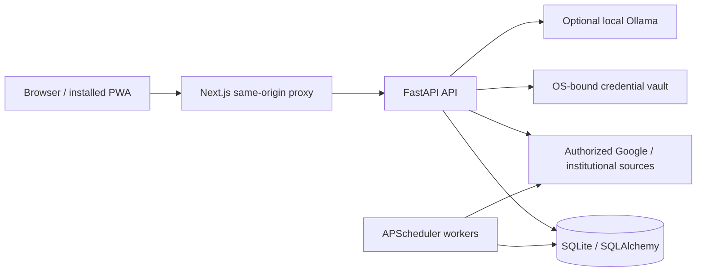

# Architecture

LifeOS is a local-first monorepo. The normal entry point is `scripts/run.py`, which starts a Next.js web server, a FastAPI API and scheduled background work. Both web/API listeners bind to loopback by default.

## Boundaries

- The browser never receives the internal API process secret. The web proxy injects it on the server and permits only explicitly routed paths.
- Server-side sessions use hashed tokens, expiry and CSRF checks. Account mode adds owner scoping; a closed-pilot configuration restricts registration and background work to a provisioned owner.
- SQLAlchemy models and explicit Alembic migrations manage persistence. Academic assignments link to tasks; exams remain calendar/academic dates rather than actionable tasks.
- Imported events retain source identifiers and timestamps. Calendar subscriptions cannot provide every institutional field, such as submission state or future enrollment.
- Provider tokens are encrypted using Windows DPAPI or a permission-restricted POSIX key. This is distinct from whole-database encryption: the working SQLite database is not encrypted.
- Uploads and document extraction are bounded by size, format, subprocess time and decoded-content limits. Files are delivered as attachments; document search is not an AI tutoring feature.
- Production script policies are generated from build artifacts and checked before startup. The main document rejects inline style attributes; required style elements remain permitted.
- Background synchronization, briefing generation, reminders and backups require the host to be running. A PWA installation does not remove that requirement.

## Main areas

`apps/web`: interface, same-origin proxy, PWA shell and frontend checks. `services/api`: domain logic, providers, sessions, storage and migrations. `services/worker`: background scheduling. `scripts`: setup, launch, recovery and explicit offline administration. `tests`: isolated backend fixtures. `deploy/linux`: preparation templates, not proof of a production public deployment.

## Engineering tradeoffs

The design favors a private personal installation with SQLite and a zero-monthly-cost baseline. Public multi-user hosting requires additional operational decisions, especially shared backup/deletion policy and Google OAuth approval. No public-service SLA or security certification is claimed.
